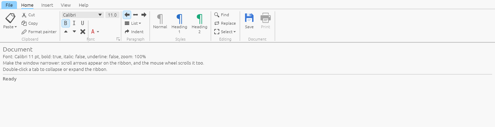
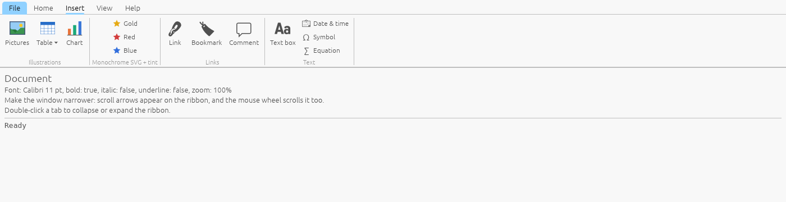
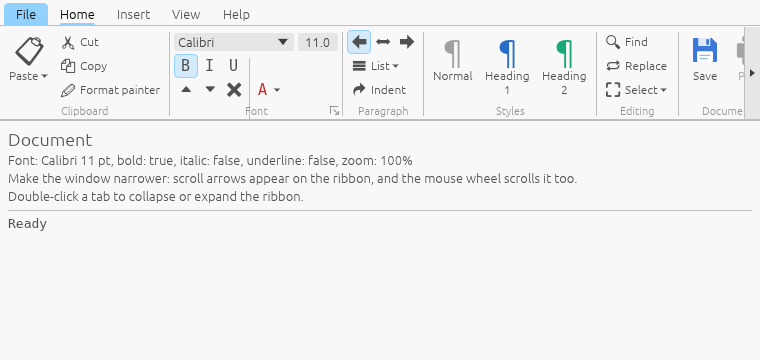
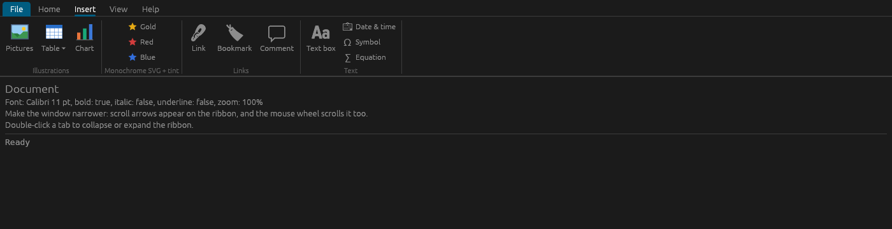

# ribbon_egui

An MS Office-style ribbon panel for [egui](https://github.com/emilk/egui) 0.36.




## Features

* Tabs, an application button ("File") with a menu, and collapsing the ribbon by double-clicking a tab.
* Captioned groups, optionally with a dialog launcher button (`group_with_launcher`).
* Large and small buttons, toggles, dropdown menu buttons, icon-only buttons, disabled buttons.
* Small items stack into columns of three automatically; `column`, `row` and `separator` give manual control.
* Any egui widget inside a group: `add(widget)`, `add_row(|ui| …)`, `add_large(|ui| …)`.
* Icons from fonts (`RibbonIcon::glyph`, `glyph_with_family`, `glyph_font`) or PNG/SVG images (`RibbonIcon::image`, `RibbonIcon::uri`), recolorable with `color(...)`.
* Horizontal scrolling when the groups don't fit: mouse wheel plus arrows at the edges (scrolls while an arrow is held).
* Light and dark themes follow egui's visuals; sizes and colors are configurable through `RibbonStyle`.




## Example

```rust
use ribbon_egui::{Ribbon, RibbonButton, RibbonIcon};

Ribbon::new("main_ribbon").show(ui, |ribbon| {
    ribbon.app_menu("File", |ui| {
        if ui.button("Open…").clicked() { /* … */ }
    });
    ribbon.tab("Home", |tab| {
        tab.group("Clipboard", |g| {
            g.large_menu('📋', "Paste", |ui| {
                let _ = ui.button("Paste text only");
            });
            g.small_button('✂', "Cut");
            g.small_button('🗐', "Copy");
        });
        let font = tab.group_with_launcher("Font", |g| {
            g.row(|r| {
                r.small_toggle(&mut bold, 'B', "");
                r.small_toggle(&mut italic, 'I', "");
            });
        });
        if font.launcher_clicked { /* open a dialog */ }
        tab.group("Document", |g| {
            let save = RibbonIcon::image(egui::include_image!("assets/save.svg"));
            g.large_button(save, "Save");
            g.button(RibbonButton::large("Print").icon('🖶').enabled(false));
        });
    });
});
```

For PNG/SVG icons, install the image loaders once at startup:

```rust
egui_extras::install_image_loaders(&cc.egui_ctx); // egui_extras with features = ["svg", "image"]
```

An icon font (Material Symbols, Phosphor, etc.) is registered as its own font family and used via
`RibbonIcon::glyph_with_family(ch, FontFamily::Name("icons".into()))`; see `setup_fonts` in the demo.

## Running

```sh
cargo run -p demo          # demo app
cargo test -p ribbon_egui  # tests (egui_kittest)
```

## License

MIT, see [LICENSE](LICENSE).
